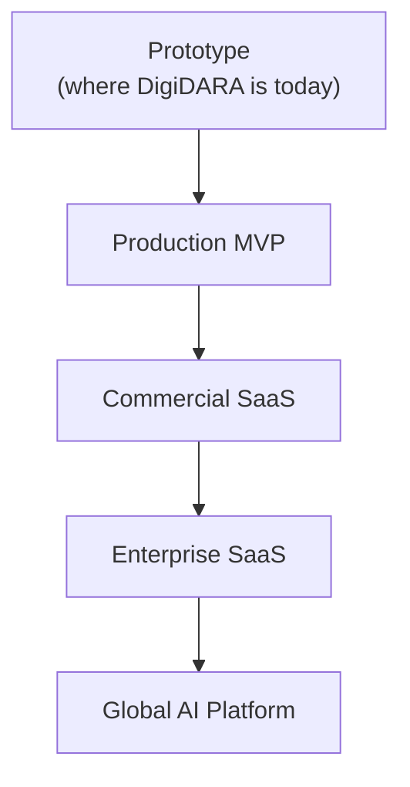

# DigiDARA — Future Vision

This document describes how DigiDARA evolves from its current state to a global AI voice platform. Each stage is defined by what must be *true* to have reached it — not a calendar date — so progress is measured honestly against evidence, the same way this documentation package treats every other claim about the system.

## Stage 1 — Prototype (Current State)

**What is true today:** A real bilingual voice agent places real outbound calls, holds a full speech-to-speech conversation grounded in an approved knowledge base, judges call termination itself via a tool call, and runs a bulk-campaign loop against a Google Sheet with do-not-call enforcement. This is not a demo — calls have been placed, recorded, billed, and analyzed on live infrastructure during this engineering pass.

**What is also true today:** it runs in one developer-operated environment with an ephemeral public ingress. CI, pinned dependencies, account lockout, and the audited organization-scoped application data boundary are implemented; operational deployment and full tenant-product capabilities are not.

**Exit criteria for this stage** (see [ENGINEERING_ROADMAP.md](#) Epics A–C): stable non-local ingress, production operations, and real-volume campaign reliability. Pinned dependencies, CI, organization-context enforcement, and account lockout are complete.

## Stage 2 — Production MVP

**Definition:** The system runs reliably for one real organization's real campaigns, with monitoring, backups, and a documented incident-response process — without yet needing to isolate multiple paying customers from each other.

**What must be true:**
- Containerized, deployed behind a stable ingress with TLS, per [DEPLOYMENT_GUIDE.md](#)'s target state.
- A real bulk-campaign run has been executed at real lead volume (hundreds of rows, not a 2–3 row test), with verified suppression enforcement and sheet write-back, per [ENGINEERING_ROADMAP.md](#) Epic D.
- Basic monitoring/alerting exists for the failure modes catalogued in [OPERATIONS_RUNBOOK.md](#).
- A documented, tested backup and restore procedure exists for the database.
- The conversation-quality issues found and fixed during the current engineering pass (dead hangup paths, prompt-driven language drift) have automated regression coverage, not just the manual live-call testing that caught them originally.

**What is deliberately *not* required yet:** multi-tenant isolation, RBAC beyond a single admin role, per-tenant credentials. Building these before there is a second real tenant to isolate from would be exactly the kind of speculative work [ENGINEERING_GUIDELINES.md](#) argues against.

## Stage 3 — Commercial SaaS

**Definition:** Multiple independent organizations use DigiDARA, each with confidence that their data, credentials, and call activity are isolated from every other organization's.

**What must be true:**
- Every item in [ENGINEERING_ROADMAP.md](#) Epic A is complete: `organization_id` derived from authenticated context everywhere, per-endpoint authorization audited, RBAC beyond binary admin, per-tenant provider credentials via `api_credentials`.
- `organizations.monthly_call_limit` is actually enforced, tying usage to a real plan/billing model.
- Harden the implemented open workspace registration with email verification, per-IP/per-identity abuse controls, account recovery, suspension, and server-enforced payment entitlements before public commercial onboarding.
- Database-backed cross-tenant access-denial tests cover the full API surface, extending the current representative unit-level isolation suite.

**What this stage is *not*:** a rewrite. Every piece of this is enforcement and completion of a boundary the schema already defines (see [ADR-008](#)) — this stage is about closing a known, already-scoped gap, not inventing new architecture.

## Stage 4 — Enterprise SaaS

**Definition:** DigiDARA meets the operational, security, and compliance bar that a larger education/training organization's procurement and security review would require.

**What must be true:**
- Full audit-logging coverage (authentication, suppression changes, data export/deletion, credential rotation, campaign changes) — not just admin-account creation, per [ENGINEERING_ROADMAP.md](#) Epic G.
- Data retention actually enforced against `organizations.data_retention_days` and `call_logs.recording_retention_until`, not merely recorded as fields.
- A documented, rehearsed incident-response process covering the scenarios in [SECURITY_GUIDE.md](#) — credential leak, suppression bypass, tenancy breach — not just a written plan that has never been exercised.
- MFA support, given `app_users.mfa_enabled` already exists as a schema field with no implementation — an enterprise buyer will ask about this specifically.
- Formal SLAs around voice-platform reliability, backed by the monitoring/alerting maturity from Stage 2 and the provider-outage response processes in [OPERATIONS_RUNBOOK.md](#).

## Stage 5 — Global AI Platform

**Definition:** DigiDARA operates across languages, telephony providers, and AI model providers beyond its current English/Tamil, Plivo, OpenAI-Realtime-only footprint, without a rewrite of its core architecture — because that architecture was already built with these seams in mind.

**What must be true:**
- A second telephony provider integrated behind the existing `app/services/telephony/` interface, proving the abstraction built in Stage 1 actually generalizes rather than only ever having one implementation.
- A second Realtime-capable (or equivalent) AI provider integrated behind an interface analogous to the telephony one, extracted from `app/api/openai_realtime.py`'s current OpenAI-specific implementation.
- Additional languages onboarded using the same pattern established by Tamil: a language-specific turn-taking/style/knowledge configuration layered on shared policy and tooling, not a parallel bespoke system per language.
- A public API surface for CRM integrations, so DigiDARA becomes a component other systems call into, not only a standalone product with its own UI.
- Genuine multi-region operation if/when latency or data-residency requirements demand it — not a speculative requirement to build against today, per [ENGINEERING_GUIDELINES.md](#)'s "no speculative abstraction" principle, but a real future consideration once evidence (a specific customer, a specific region) makes it concrete.

## The Throughline

Every stage above builds on real, already-laid groundwork rather than requiring architectural reinvention: the multi-tenant schema exists before tenancy is enforced; the provider abstraction exists before a second provider is integrated; the bilingual pattern (shared policy + language-specific layer) exists before a third language is added. The work between here and a global platform is consistently about *finishing what the architecture already anticipates*, proven at each stage with real evidence — a real campaign run, a real cross-tenant test, a real second provider — rather than declared complete on paper.
