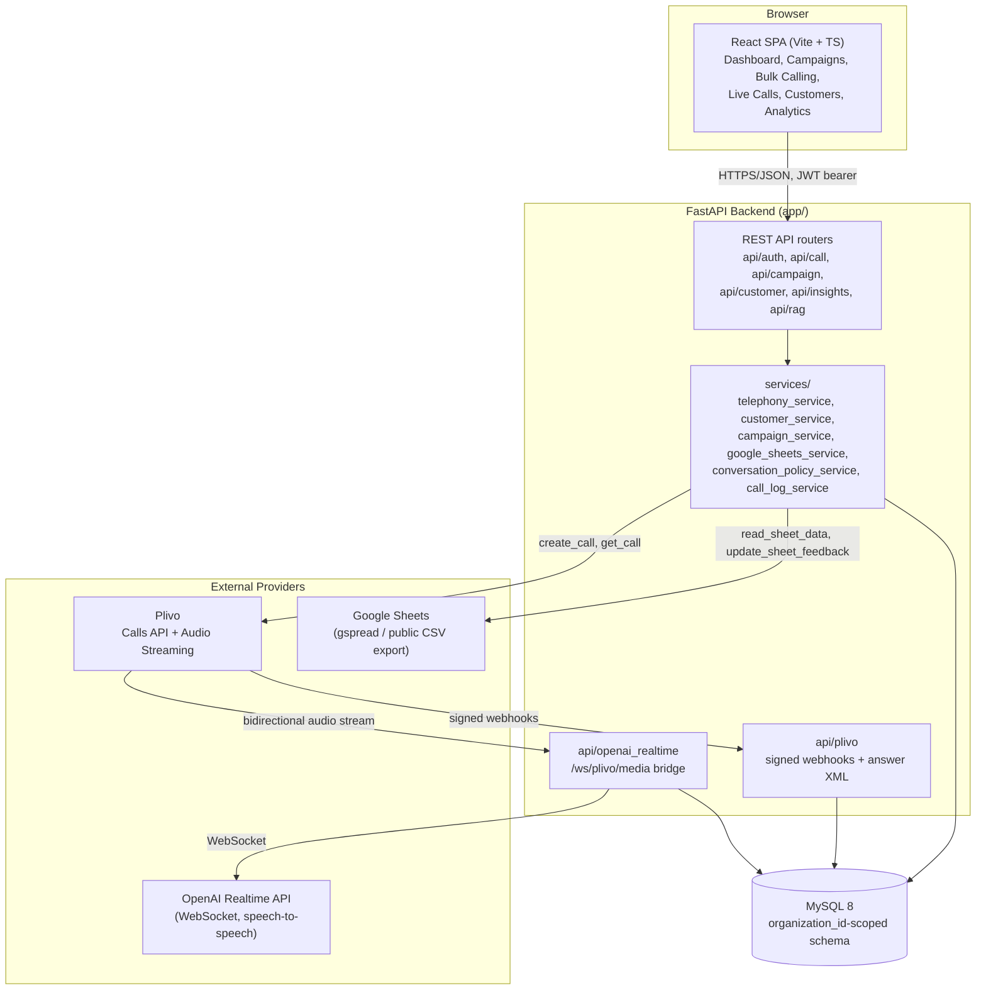
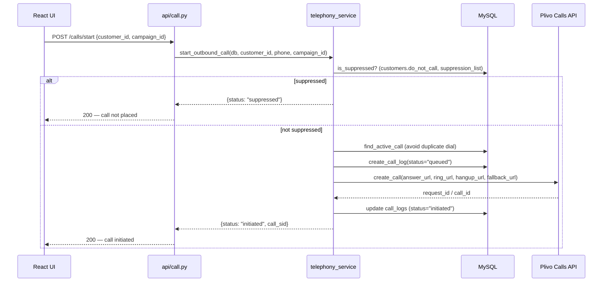
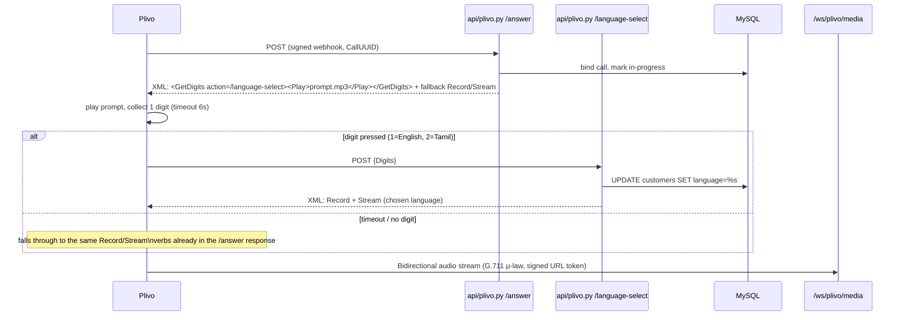
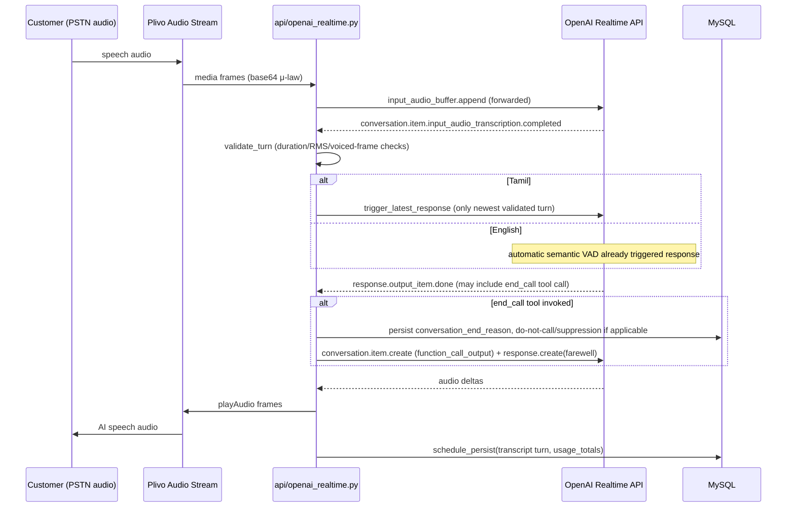

# DigiDARA — System Architecture

## 1. High-Level Architecture

DigiDARA is a three-tier system: a React/TypeScript single-page application, a FastAPI backend that owns all business logic and provider integrations, and a MySQL database. Two external providers sit on the call path itself — Plivo for telephony and OpenAI for the Realtime conversational engine — and a third, Google Sheets, sits on the campaign-automation path.

## 2. Module Boundaries

| Layer | Path | Responsibility |
|---|---|---|
| API routing | `app/api/*.py` | HTTP/WebSocket endpoints only — request parsing, auth dependency injection, response shaping. Business logic is delegated to `services/`. |
| Domain services | `app/services/*.py` | All business rules: call orchestration, campaign automation, conversation policy, customer upsert, cost calculation, suppression enforcement. |
| Telephony provider abstraction | `app/services/telephony/` | Provider-neutral interface (`get_telephony_provider()`) with a Plivo implementation (`plivo_provider.py`) and shared status mapping (`status.py`). Designed so a second carrier can be added without touching `telephony_service.py`'s orchestration logic. |
| Data access | Raw SQL via `PyMySQL`, dict cursors | No ORM. Every service function that touches the database takes a live `conn`/`db` connection and issues parameterized SQL directly. This is a deliberate simplicity choice for a small backend team, not an oversight — see [ARCHITECTURE_DECISION_RECORD.md](#) for the tradeoffs. |
| Schemas | `app/schemas/*.py` | Pydantic request/response models, used for input validation at API boundaries. Not all persisted fields have a corresponding schema field (e.g., `sheet_url`/`sheet_row` on `customers` are written via raw SQL in `customer_service.upsert_customer`, deliberately bypassing the Pydantic schema which does not model them). |
| Models | `app/models/*.py` | Lightweight SQLAlchemy-style column declarations used for schema documentation/reference; the live request path does not use an ORM session against these. |
| Frontend | `src/` | `pages/` (route-level screens: Overview, Customers, Campaigns, Live Calls, Bulk Calling, Leads, Analytics, Knowledge Base, Playground, Integrations, Team & Roles, Usage & Billing), `components/` (layout + reusable UI + charts), `hooks/`, `api/` (typed HTTP client wrappers), `types/`. |

## 3. Backend Architecture

The backend is organized as a set of FastAPI routers mounted onto a single application, each thin, delegating to services:

- `app/api/auth.py` — protected legacy first-admin bootstrap, open workspace plus first-admin registration, workspace-aware login, and same-workspace admin creation. JWT issuance/verification and lockout-aware authentication live in `app/services/auth_service.py`; atomic workspace provisioning lives in `app/services/workspace_service.py`.
- `app/api/customer.py` — CRM CRUD for leads/customers.
- `app/api/campaign.py` — campaign CRUD (name, objective, AI prompt, status).
- `app/api/call.py` — the largest router: single-call initiation, the Plivo/OpenAI voice_welcome and voice_respond legacy-adjacent handlers, `/calls/run-sheet` (the bulk-campaign entry point), and per-call CRM update logic (language persistence, transcript/summary handling).
- `app/api/plivo.py` — every Plivo webhook: `/answer` (now serves the language-selection DTMF menu before starting the media stream), `/language-select` (handles the keypress and returns the actual stream-start XML), `/ring`, `/hangup` (finalizes the call log and reconciles real billing from Plivo's CDR), `/recording`, `/stream-status`, `/inbound`. All webhook bodies are validated against Plivo's V3 HMAC signature before being trusted.
- `app/api/openai_realtime.py` — the WebSocket bridge (`/ws/plivo/media`) between Plivo's bidirectional audio stream and OpenAI's Realtime API. This is the largest and most behaviorally sensitive module in the codebase; see Section 6 and [VOICE_PLATFORM.md](#).
- `app/api/insights.py`, `app/api/lead_score.py`, `app/api/rag.py`, `app/api/chat.py` — analytics, lead scoring, knowledge-base retrieval, and an in-app assistant chat surface.
- `app/api/conversation_relay.py`, `app/services/twilio_service.py` — a Twilio-era voice path retained in the repository but not the active production call path (the active path is Plivo + OpenAI Realtime, per `IMPLEMENTATION_REPORT.md`'s confirmed production trace).

Cross-cutting services:

- `telephony_service.py` — `start_outbound_call` (single choke point for placing any outbound call, including the do-not-call/suppression gate), `trigger_next_queued_call` (bulk-campaign queue advancement), `is_suppressed`, phone normalization.
- `customer_service.py` — CRUD plus `upsert_customer`, the find-or-create-by-synthesized-email logic that lets sheet rows (which have no real email address) resolve to a stable CRM customer record.
- `google_sheets_service.py` — sheet reading (authenticated via `credentials.json` when present, else a public CSV-export fallback), header normalization (recognizing header variants like "Phone No", "Ph No", "Phone Number" for the phone column), and write-back (`update_sheet_feedback`/`update_sheet_status`), which has no fallback and raises if no service-account credentials are configured.
- `conversation_policy_service.py` — the system-prompt builders for both languages (`build_shared_conversation_policy`, `build_tamil_language_policy`, `build_english_language_policy`, and the full instruction assemblers used at session start and mid-call), plus `classify_intent` for structured intent tagging (fees/duration/batch/timing/etc., and terminal intents like `stop`, `end_call`, `callback`, `language_switch`).
- `conversation_end.py` — regex-based explicit end-of-call phrase detection, used as a structured signal alongside (not instead of) the model's own `end_call` tool judgment.
- `call_log_service.py` — call lifecycle state transitions and idempotent provider-callback binding.

## 4. Frontend Architecture

The frontend is a single Vite-built React app (`src/`) using file-based route pages under `src/pages/`, a shared layout shell (`src/components/layout/`), and `@tanstack/react-query` for all server data fetching/caching against the FastAPI backend via `axios` (`src/api/`). Charting (campaign performance, cost/analytics dashboards) uses `recharts`. There is no server-side rendering; the app is a pure client-rendered SPA served by Vite in development and a static build in any deployed environment.

Key screens map directly to backend capability, not the reverse — the UI does not have logic paths unsupported by the API (e.g., Bulk Calling's UI explicitly states the sheet-column requirements the backend's `normalize_headers()` actually recognizes, rather than presenting a generic upload flow the backend can't fulfill).

## 5. Voice Platform

See [VOICE_PLATFORM.md](#) for full detail. Summary: Plivo places the outbound call and answers with an XML document that (a) offers a DTMF language menu, pre-rendered via OpenAI TTS since Plivo cannot speak Tamil natively, then (b) opens a bidirectional, recorded audio stream to `/ws/plivo/media`. That WebSocket handler bridges raw G.711 μ-law audio frames both ways to a second WebSocket connection to OpenAI's Realtime API, which performs speech-to-speech conversation directly — there is no separate ASR → LLM → TTS pipeline in the live path for the conversation itself (a transcription model runs in parallel for logging/intent-classification purposes, billed and tracked separately).

## 6. AI Platform

See [AI_PLATFORM.md](#) for full detail. Summary: the two languages run on **deliberately different turn-taking architectures** inside the same Realtime session type:

- **English** uses OpenAI's automatic server voice-activity detection with a bounded 650 ms silence window (`create_response: true`), the established consultative-sales prompt flow, and immediate interrupt-and-clear-playback behavior on barge-in.
- **Tamil** uses a manual, validated-latest-turn planner (`create_response: false`): incoming audio is buffered, RMS-validated to reject noise/false triggers, and only the newest validated customer turn is submitted for a response, with an explicit `trigger_latest_response` call — because Tamil callers' turn-taking rhythm and background-noise profile in early production testing did not suit automatic VAD as well as English did.
- Both languages share one policy layer (`build_shared_conversation_policy`) for universal behavior (AI disclosure, end-of-call judgment via the `end_call` tool) and one knowledge-retrieval mechanism, but have independent language-specific style/persona prompt builders.

## 7. Knowledge Platform

Course, fee, batch, and process facts are retrieved per-turn from an approved knowledge base (`app/services/knowledge_base.py` for English, `knowledge_base_ta.py`/`knowledge_ta.txt` for Tamil) and injected into the model's context only when the customer's question is classified as needing it (`should_retrieve_knowledge`), rather than loading the full knowledge corpus into every session — this keeps token cost and answer latency down and reduces the chance of the model surfacing unapproved information. An in-memory BM25 index is built over the Tamil knowledge documents at process startup (visible in test output as `[InMemoryKB] Loaded N ta documents into RAM` / `ta BM25 index built`). A separate retrieval-augmented endpoint (`app/api/rag.py`, `app/services/rag_service.py`) exists for the in-app assistant/chat surface, distinct from the live-call knowledge path.

## 8. Infrastructure

Current development infrastructure is intentionally minimal: a local MySQL instance, the FastAPI app run directly via Uvicorn, the Vite dev server for the frontend, and a Cloudflare Quick Tunnel providing the public HTTPS/WSS endpoint Plivo's webhooks and audio stream connect to. There is no containerization, orchestration, CI/CD pipeline, or infrastructure-as-code in the repository today. This is appropriate for the current single-environment, single-developer-operated stage of the product and is addressed as a near-term roadmap item, not a defect in the architecture itself — see [DEPLOYMENT_GUIDE.md](#).

## 9. Sequence Diagrams

### 9.1 Request Flow — Placing a Single Outbound Call

### 9.2 Voice Flow — Answer Through Language Selection to Stream Start

### 9.3 Realtime Flow — Live Conversation Turn

## 10. Design Notes on Provider Isolation

Two provider boundaries are already abstracted in a way that materially reduces future integration cost:

- **Telephony**: `get_telephony_provider()` returns an interface implemented today by `PlivoProvider`; call orchestration (`telephony_service.py`) never imports Plivo's SDK directly.
- **AI conversation**: the Realtime bridge is isolated to `app/api/openai_realtime.py`; conversation policy (prompt construction, intent classification) lives in a separate service layer that does not depend on OpenAI-specific types, which is what made it possible to add a new tool (`end_call`) and a new state variable (`pending_tool_call`) without restructuring the policy layer.

Google Sheets and the telephony CDR-billing reconciliation are not yet behind equivalent abstractions — each has exactly one concrete implementation used directly by the service layer that calls it. This is a reasonable state for a single-provider product today and is called out explicitly, rather than silently, as a scaling consideration in [TECHNICAL_DEBT.md](#).
