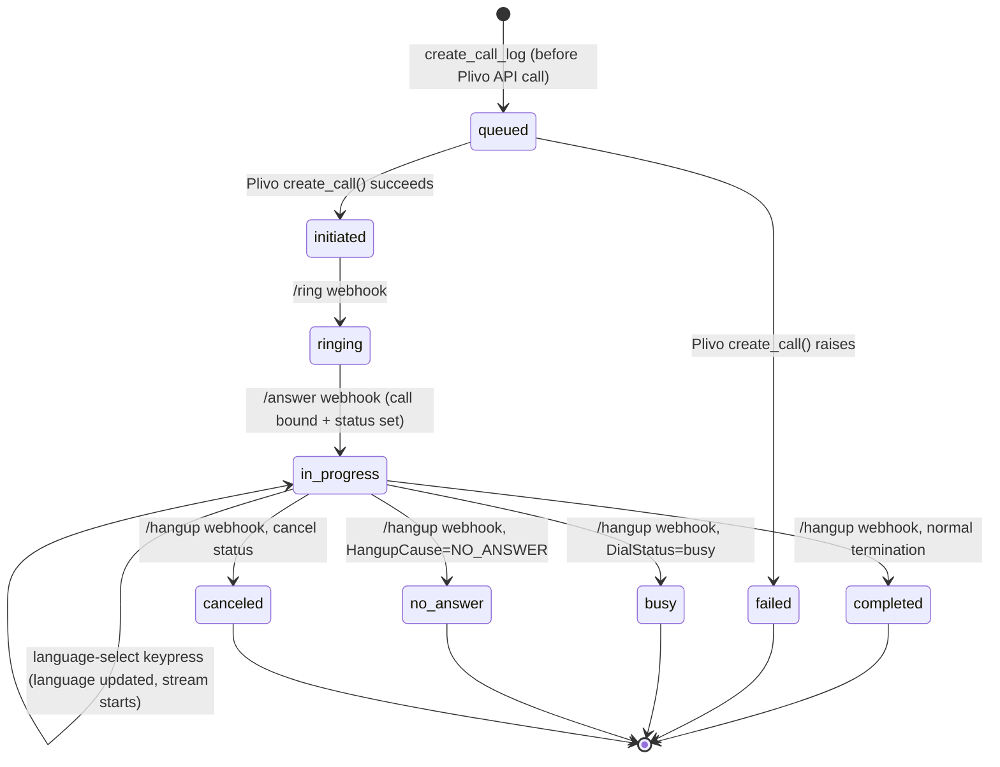

# DigiDARA — Voice Platform

## Realtime Architecture

The live conversation is a direct, bidirectional bridge between Plivo's audio stream and OpenAI's Realtime API — there is no intermediate transcribe-then-generate-then-synthesize pipeline for the conversation itself. `app/api/openai_realtime.py`'s `/ws/plivo/media` WebSocket endpoint holds one connection to Plivo (raw G.711 μ-law audio frames, 8kHz) and one connection to OpenAI (`wss://api.openai.com/v1/realtime?model=...`), and moves audio both directions with minimal transformation. A parallel, separately-billed transcription model (`gpt-4o-transcribe` for Tamil, `gpt-4o-mini-transcribe` for English by default, configurable per language) produces text transcripts of customer speech for logging, intent classification, and knowledge-retrieval triggering — it does not sit in the audio-generation path itself.

Session configuration is established via a `session.update` event sent once the OpenAI WebSocket connects, carrying: the assembled system instructions (see [AI_PLATFORM.md](#)), voice/turn-detection parameters (different per language — see below), and the tool definitions available to the model, currently just `end_call`.

## Plivo Integration

- **Outbound call creation:** `PlivoProvider.create_call()` (`app/services/telephony/plivo_provider.py`) calls Plivo's Calls API with `answer_url`, `ring_url`, `hangup_url`, and `fallback_url`, each carrying `customer_id`, `campaign_id`, and a generated `correlation_id` as query parameters so every subsequent webhook can be bound back to the right `call_logs` row.
- **Maximum call duration:** every individual and bulk call receives Plivo's `time_limit` from `CALL_MAX_DURATION_SECONDS` (default 900 seconds, bounded to 60-86,400). The applied value is retained in `provider_metadata` so historical call review uses the limit that was active when the call was placed.
- **Webhook signature validation:** every webhook (`/answer`, `/language-select`, `/ring`, `/hangup`, `/recording`, `/stream-status`, `/inbound`) is validated against Plivo's V3 HMAC signature scheme before its payload is trusted (`_signed_form` in `app/api/plivo.py`), using the `X-Plivo-Signature-V3` and `X-Plivo-Signature-V3-Nonce` headers. Validation is on by default (`PLIVO_VALIDATE_SIGNATURES`) and is forced on outside of `development` environment mode regardless of that flag.
- **Idempotent event handling:** `_claim_event()` inserts into `provider_callback_events` with `INSERT IGNORE` on a `(provider, event_type, event_key)` uniqueness constraint; a retried Plivo webhook delivery (which Plivo does on timeout) becomes a no-op rather than re-triggering call-log state transitions or CRM side effects a second time.
- **CDR-based billing reconciliation:** at `/hangup`, after the call-log status is finalized, `get_telephony_provider().get_call(call_id)` is called against Plivo's own Call Detail Record API and used to overwrite `estimated_telephony_cost_usd`/`provider_bill_duration_seconds` with the provider's authoritative billed figures — this update is allowed to run on retried hangup callbacks (unlike the CRM-affecting finalize step, which is idempotency-gated) specifically because CDR data can lag the first hangup callback and a later retry may carry the real, settled billing figure.
- **Recording:** every call is recorded (`<Record recordSession="true" recordChannelType="stereo" fileFormat="mp3">`) with a callback URL for the recording metadata, `maxLength` capped between 60 seconds and 14,400 seconds (4 hours) regardless of what's configured, as a sanity bound.

## Call Lifecycle

Status values are normalized from Plivo's raw `CallStatus`/`HangupCause` vocabulary into the product's own status set via `map_plivo_status()` (`app/services/telephony/status.py`), so the rest of the system never branches on Plivo-specific string values directly.

If Cloudflare loses the terminal webhook, authenticated call-log polling performs a narrow recovery check for answered Plivo calls that are at least 45 seconds old and never established a media stream. `call_reconciliation_service.py` asks Plivo for the authoritative CDR and finalizes the row only when its hangup cause maps to a terminal product status. A missing local stream ID or elapsed time alone never terminates a call. This complements the broader two-hour startup cleanup and prevents failed pre-stream calls from remaining permanently visible as live.

## Call-Start Language Selection

Every outbound call now opens with a DTMF menu before the AI stream begins, rather than assuming language from campaign or sheet metadata:

1. `/answer` returns a Plivo `<GetDigits>` document: a pre-rendered audio prompt ("For English, press 1. தமிழுக்கு, இரண்டை அழுத்தவும்.") played via `<Play>`, with `action` pointing at `/language-select` and the same Record/Stream verbs that would normally start the call placed immediately after `</GetDigits>` as a fallback.
2. If the customer presses `1` or `2` within the timeout (6 seconds, one retry), Plivo POSTs to `/language-select`, which updates both `customers.language` and the current `call_logs.language` accordingly and returns a fresh Record/Stream document to actually start the AI conversation in that language.
3. If no valid digit arrives, Plivo — per its own documented `<GetDigits>` behavior — falls through to the next verbs in the *original* `/answer` response, which is the same Record/Stream pair, using whatever language the customer record already carries (default English). The call is never stalled waiting on a keypress that doesn't come.

The prompt is pre-rendered once via OpenAI's TTS REST endpoint (`POST /v1/audio/speech`, model `gpt-4o-mini-tts`) rather than spoken live by Plivo, because Plivo's native `<Speak>` has no Tamil voice — confirmed on a live test call where the English half of a mixed-language `<Speak>` prompt played correctly and the Tamil half produced only silence. The TTS request uses a slower, clearly projected phone-menu delivery. The returned WAV is converted with Python's standard library to mono 16 kHz PCM and gain-normalized toward -16 dBFS RMS with a -1 dBFS peak ceiling, then cached as `static/language_prompt_v2.wav`. The versioned `/api/plivo/language-prompt-v2.wav` URL prevents callers from receiving the earlier quiet cached MP3.

## Configurable Department IVR

An organization can optionally enable a second, tenant-scoped menu after the caller has selected English or Tamil. An administrator configures digits, spoken labels, and a target campaign in the IVR Menu screen. The menu is disabled by default, and enabling it requires at least one active option whose target campaign belongs to the same organization. A selected digit is saved exactly once in `call_ivr_selections`, updates the live call's campaign, and then starts the normal Realtime stream with that campaign's policy. Retried signed callbacks reuse the originally recorded route. Invalid input and no input fall through to the original campaign's existing stream rather than leaving a caller in IVR.

The menu uses a short bilingual OpenAI TTS clip rendered on demand and cached by prompt digest. The public audio URL is protected by a random, rotated configuration token; the configuration and option APIs remain administrator-authenticated. It carries no customer data or credentials. This IVR routes only to an AI campaign; an operator may separately use the live Human Transfer workflow when a confirmed staff handoff is appropriate.

## Post-Answer Caller Inactivity

The active Realtime bridge runs one shared post-answer inactivity watchdog for both individual and Google Sheet bulk calls. The timer starts after the initial AI greeting has completed and only advances while the bridge is listening for the customer. Assistant response start/completion invalidates any running countdown, and a fresh interval begins only after assistant generation and queued Plivo playback are complete.

- `CALL_INACTIVITY_REPROMPT_SECONDS` controls the first silent interval (default 15 seconds, bounded to 5–120 seconds).
- After the first interval, the assistant asks once in the active English/Tamil language whether the customer is still on the line.
- `CALL_INACTIVITY_HANGUP_SECONDS` controls the second silent interval (default 10 seconds, bounded to 3–60 seconds).
- Detected caller speech resets the flow to the first interval, including when the caller responds during the reprompt.
- A second timeout records `conversation_end_reason='inactivity_timeout'`, plays a short language-appropriate goodbye, waits for its playback checkpoint through the existing graceful-hangup path, and terminates the Plivo call.

Because individual and bulk calls converge on `/ws/plivo/media`, no separate queue-specific timer exists. For a bulk call, the normal signed `/hangup` lifecycle callback finalizes the call and advances the campaign queue after provider termination.

## Cost and Conversation Guardrails

Completed call-log API responses include derived turns/minute, interruptions/minute, estimated combined INR, estimated INR/minute, an `is_abnormal` flag, and stable reason codes. The dashboard and Calls screen surface those warnings for operator review. Thresholds are configurable through `CALL_ESTIMATED_COST_ALERT_INR`, `CALL_ESTIMATED_COST_PER_MINUTE_ALERT_INR`, `CALL_TURNS_PER_MINUTE_ALERT`, `CALL_INTERRUPTION_ALERT_COUNT`, and `CALL_FALSE_TURN_ALERT_COUNT`.

These are observability signals, not conversation policy. They do not terminate a call or weaken normal turn-taking. Only the provider-side maximum-duration limit enforces an automatic stop. Cost values remain estimates and provider invoices remain authoritative.

## Conversation Flow

See [AI_PLATFORM.md](#) for the full conversational architecture. At the voice-platform layer, English lets OpenAI's automatic server VAD decide when to respond and allows immediate interruption. It uses a 650 ms silence window (`OPENAI_SERVER_VAD_SILENCE_MS_ENGLISH`, bounded to 400–1,500 ms), 300 ms prefix padding, and threshold 0.5. This replaced semantic `medium` after call 47 measured 4.813-second first and 5.375-second maximum caller-visible latency; semantic `high` had previously fragmented call 44. Tamil retains semantic `high` eagerness, then buffers and validates each turn (minimum duration, peak RMS, voiced-frame count), discards rejected turns via `conversation.item.delete`, and explicitly triggers a response only for the newest validated turn.

## Error Recovery

- **Dead webhook tunnel:** in local development, the public webhook URL is an ephemeral Cloudflare Quick Tunnel hostname; if the tunnel process restarts, the hostname changes and any call attempt against the stale hostname fails with a Plivo `ValidationError` ("answer_url parameter is not valid") because the URL no longer resolves. This is a known development-environment failure mode, not a code defect — the remediation is a stable ingress for any non-local environment (see [ENGINEERING_ROADMAP.md](#) Epic C).
- **Retried provider webhooks:** handled via the `provider_callback_events` idempotency ledger (above) — safe by design, not by luck.
- **Rejected/false conversational turns:** Tamil's turn-validation planner explicitly deletes rejected input items from the OpenAI conversation state (`conversation.item.delete`) so a false trigger (background noise, a stray sound) never pollutes the model's context or produces a spurious response.
- **Barge-in / interruption:** on a genuine customer interruption, queued assistant audio already sent to Plivo is cleared (`clearAudio` stream-protocol message) in addition to canceling the in-flight OpenAI response — canceling the response alone does not remove audio Plivo has already buffered for playback, which is why both steps are necessary.
- **Call-creation failure:** `start_outbound_call` catches any exception from `provider.create_call()`, records a generic, non-leaking failure reason (`f"Plivo call creation failed ({type(exc).__name__})"`) to `call_logs`, and returns a clean failure response rather than propagating a raw provider exception (which could include sensitive request detail) to the caller.
